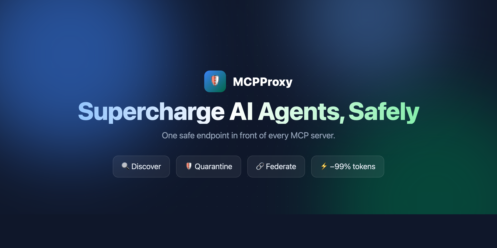
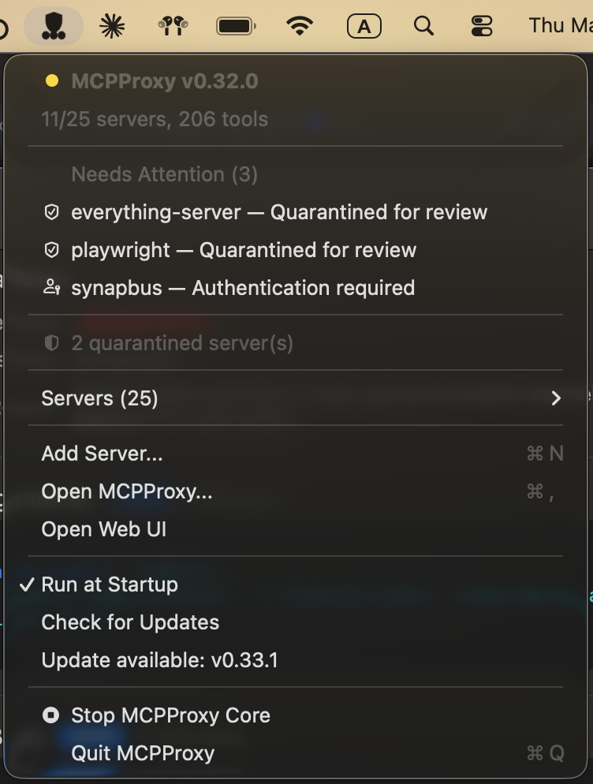
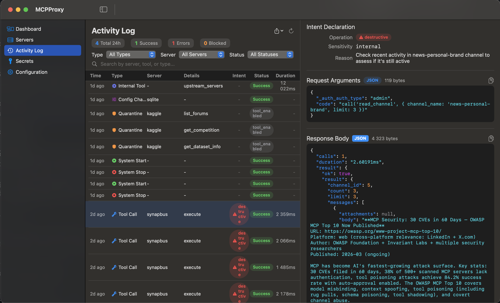

<p align="center">
  <a href="https://mcpproxy.app" target="_blank" rel="noopener">
    
  </a>
</p>

<div align="center">

[](https://github.com/smart-mcp-proxy/mcpproxy-go/releases)
[](https://github.com/smart-mcp-proxy/mcpproxy-go/actions/workflows/unit-tests.yml)
[](https://goreportcard.com/report/github.com/smart-mcp-proxy/mcpproxy-go)
[](https://pkg.go.dev/github.com/smart-mcp-proxy/mcpproxy-go)
[](LICENSE)
[](https://github.com/smart-mcp-proxy/mcpproxy-go/stargazers)
[](https://securityscorecards.dev/viewer/?uri=github.com/smart-mcp-proxy/mcpproxy-go)

</div>

<p align="center">
  
</p>

<p align="center">
  <strong>📺 <a href="https://youtu.be/2aKrgJnbbcw">Watch the full walkthrough</a></strong> &nbsp;·&nbsp;
  <strong>📚 <a href="https://docs.mcpproxy.app/">Read the docs</a></strong> &nbsp;·&nbsp;
  <strong>🌐 <a href="https://mcpproxy.app">mcpproxy.app</a></strong>
</p>

> The demo above shows the **embedded web UI**. The MCPProxy **core is a single binary for macOS, Linux, and Windows** — the web UI ships inside it, with no extra service to run. On **macOS**, an optional **menu‑bar app** adds one‑click convenience (start/stop, server health, quarantine, logs).

<div align="center">
  
  &nbsp;&nbsp;&nbsp;&nbsp;
  
  <br />
  <em>macOS menu‑bar app &nbsp;&nbsp;·&nbsp;&nbsp; Activity log &amp; audit in the macOS app</em>
</div>


## Why MCPProxy?

- **Scale beyond API limits** – Federate hundreds of MCP servers while bypassing Cursor's 40-tool limit and OpenAI's 128-function cap.
- **Spend less context on tool definitions** – Agents see a small set of MCPProxy discovery and execution tools (`retrieve_tools`, `describe_tool`, the `call_tool_*` variants and a few management tools) instead of the full upstream tool catalog, and fetch schemas on demand (in `retrieve_tools` and `code_execution` routing; `direct` routing exposes upstream tools individually, see [Routing modes](https://docs.mcpproxy.app/features/routing-modes/)). How much context this saves depends on the number of tools, the routing mode, the client and the task; see [Token savings: what is and is not measured](#token-savings-what-is-and-is-not-measured).
- **Review before use** – New servers are quarantined and their tools are withheld from agents until you review and approve them, and, under the default `manual` trust mode, most later changes to an approved tool's definition are held for review again. Known exceptions: input-schema-only edits outside `scan` mode, a newly added output schema, and a description added to a tool that was approved with an empty description are admitted without a hold; `scan` mode admits clean changes and misses what its detectors miss; `auto` mode does not hold changes. This reduces exposure to malicious tool definitions (Tool Poisoning Attacks); it is not a guarantee of safety. See [What quarantine does and does not cover](https://docs.mcpproxy.app/features/security-quarantine/#what-quarantine-does-and-does-not-cover).
- **Pluggable security scanners** – Run Snyk, Semgrep, Trivy, Cisco, and other Docker-based scanners against quarantined servers before you approve them; findings are normalized to SARIF with a composite risk score. See [Security scanner plugins](https://docs.mcpproxy.app/features/security-scanner-plugins/).
- **Works offline & cross-platform** – A single core binary for macOS (Intel & Apple Silicon), Windows (x64 & ARM64), and Linux (x64 & ARM64), with the **web UI embedded**. macOS additionally ships an optional menu-bar app.

## Token savings: what is and is not measured

On-demand discovery reduces how many upstream tool definitions an agent loads into context up front. The saving is not a fixed percentage: it grows with the number of connected tools and depends on the routing mode, the client and the task. MCPProxy does not publish a headline token-reduction or accuracy-improvement figure, and it makes no latency claim.

What the repository does measure, as a first-party, deterministic estimate (see [`bench/README.md`](bench/README.md) for the method and to reproduce it with `go run ./bench/cmd/bench`):

- Corpus: the frozen 45-tool reference corpus; counting tool **name and description only** (input schemas excluded), `cl100k_base`.
- Metric: size of the initial tool menu in tokens, including the proxy's own discovery, call and management tools. Not total workflow tokens, not latency, and not task success.
- Result: on that 45-tool corpus the proxy's initial menu is **larger** than listing every upstream tool (2625 tokens in `retrieve_tools` mode and 1874 in `code_execution` mode, against 1730 for the baseline), because the proxy's own tools have a fixed cost. A saving appears only above a break-even number of upstream tools, so quote the tool count with any percentage.

---

## Quick Start

### Fastest: paste this into your agent

Paste the prompt below into Claude Code, Codex or another coding agent. It installs MCPProxy for your OS, starts it, and connects the client it is running in. It stops to ask before touching an existing install and never prints your keys. ([Same prompt on the docs site](https://docs.mcpproxy.app/getting-started/agent-install).)

<!-- agent-install-prompt:start -->
```text
Install MCPProxy (https://mcpproxy.app), start it, and connect it to the AI client you are running in. Work step by step and show me each command before you run it.

RULES
- Do not read, print or paste ~/.mcpproxy/mcp_config.json, any API key, token or credential. Use the commands below, which return masked output.
- If MCPProxy is already installed or running (step 1), STOP and ask me what to do. Never reinstall over a running instance.
- Do not use sudo unless a step needs it; tell me first.
- Install only from the sources listed here and verify checksums where stated.

1. CHECK FOR AN EXISTING INSTALL
   Run: command -v mcpproxy   (Windows PowerShell: Get-Command mcpproxy)
   Then: mcpproxy status      (it reports whether an instance is running)
   If either shows MCPProxy is present or running, report that and ask me before doing anything else.

2. INSTALL (pick the first that applies to this OS)
   macOS / Linux with Homebrew:   brew install smart-mcp-proxy/mcpproxy/mcpproxy
   Windows with winget:           winget install --id smart-mcp-proxy.mcpproxy -e
   Windows with scoop:            scoop bucket add mcpproxy https://github.com/smart-mcp-proxy/scoop-bucket ; scoop install mcpproxy
   Otherwise (Linux without Homebrew, or no package manager), the release archive:
     VER=$(curl -fsSL https://api.github.com/repos/smart-mcp-proxy/mcpproxy-go/releases/latest | sed -n 's/.*"tag_name": *"v\([^"]*\)".*/\1/p' | head -1)
     OS=linux; ARCH=$(uname -m | sed 's/x86_64/amd64/;s/aarch64/arm64/')    # use OS=darwin on macOS
     cd "$(mktemp -d)"
     curl -fsSLO "https://github.com/smart-mcp-proxy/mcpproxy-go/releases/download/v${VER}/mcpproxy-${VER}-${OS}-${ARCH}.tar.gz"
     curl -fsSLO "https://github.com/smart-mcp-proxy/mcpproxy-go/releases/download/v${VER}/checksums.txt"
     grep " mcpproxy-${VER}-${OS}-${ARCH}.tar.gz\$" checksums.txt | (sha256sum -c - 2>/dev/null || shasum -a 256 -c -)
     tar xzf "mcpproxy-${VER}-${OS}-${ARCH}.tar.gz" && mkdir -p ~/.local/bin && install -m 0755 mcpproxy ~/.local/bin/mcpproxy
     mkdir -p ~/.mcpproxy && echo curl > ~/.mcpproxy/install-channel     # records the install channel only
     (Make sure ~/.local/bin is on PATH; the checksum line must print "OK" or STOP.)
   Prefer the macOS desktop app? Tell me; it is: brew install --cask smart-mcp-proxy/mcpproxy/mcpproxy

3. START IT
   mkdir -p ~/.mcpproxy && mcpproxy serve --listen 127.0.0.1:8080 > ~/.mcpproxy/serve.log 2>&1 &     # Windows: Start-Process mcpproxy -ArgumentList serve -WindowStyle Hidden
   If port 8080 is taken, use another, e.g. --listen 127.0.0.1:18080.
   It must keep running after your command returns: start it with your tool's background/long-running mode rather than relying on a trailing `&`, which some agent shells kill when the call ends.
   Wait until `mcpproxy status` reports it is running (retry for up to 30 seconds). Never run `mcpproxy status --show-key` or `--web-url`: they print the admin key.

4. VERIFY (these commands print masked output)
   mcpproxy status
   mcpproxy doctor

5. CONNECT THE CLIENT YOU ARE RUNNING IN
   Claude Code: mcpproxy connect claude-code
   Codex:       mcpproxy connect codex
   Others (cursor, windsurf, vscode, gemini, opencode): mcpproxy connect <client>
   Claude Desktop is not in this list: tell me to open the Connect wizard in the MCPProxy Web UI at http://127.0.0.1:<port>/ui/ (I can get my sign-in link by running `mcpproxy status --web-url` myself in a terminal; do NOT run that command, it prints the admin key).
   Then run: mcpproxy connect --list   and confirm the client shows as connected.

6. TELL ME WHAT HAPPENED
   - What you installed and how, and the Web UI address http://127.0.0.1:<port>/ui/ (never include an API key or a URL containing `apikey=`).
   - That the client needs a reload or restart before it sees MCPProxy (Claude Code: start a new session or run /mcp; Codex: restart it). Do not claim it is connected until I have done that.
   - MCPProxy sends anonymous usage telemetry. To turn it off: set MCPPROXY_TELEMETRY=false before starting it, or toggle it in Settings. Details: https://docs.mcpproxy.app/features/telemetry
```
<!-- agent-install-prompt:end -->

### 1. Install

**macOS (Recommended - DMG Installer):**

Download the latest DMG installer for your architecture:
- **Apple Silicon (M1/M2):** [Download DMG](https://github.com/smart-mcp-proxy/mcpproxy-go/releases/latest) → `mcpproxy-*-darwin-arm64.dmg`
- **Intel Mac:** [Download DMG](https://github.com/smart-mcp-proxy/mcpproxy-go/releases/latest) → `mcpproxy-*-darwin-amd64.dmg`

**Windows (Recommended - Installer):**

Download the latest Windows installer for your architecture:
- **x64 (64-bit):** [Download Installer](https://github.com/smart-mcp-proxy/mcpproxy-go/releases/latest) → `mcpproxy-setup-*-amd64.exe`
- **ARM64:** [Download Installer](https://github.com/smart-mcp-proxy/mcpproxy-go/releases/latest) → `mcpproxy-setup-*-arm64.exe`

The installer automatically:
- Installs both `mcpproxy.exe` (core server) and `mcpproxy-tray.exe` (system tray app) to Program Files
- Adds MCPProxy to your system PATH for command-line access
- Creates Start Menu shortcuts
- Supports silent installation: `.\mcpproxy-setup.exe /VERYSILENT`

**Alternative install methods:**

macOS (Homebrew):
```bash
# macOS — GUI tray app (recommended):
brew install --cask smart-mcp-proxy/mcpproxy/mcpproxy

# macOS / Linux — headless CLI only:
brew install smart-mcp-proxy/mcpproxy/mcpproxy
```

The cask installs the menu-bar app (bundles the CLI); the formula is the CLI binary only. Both update via `brew upgrade`.

Linux (Debian/Ubuntu) — apt repository, auto-updates via `apt upgrade`:
```bash
sudo install -m 0755 -d /etc/apt/keyrings
curl -fsSL https://apt.mcpproxy.app/mcpproxy.gpg \
  | sudo tee /etc/apt/keyrings/mcpproxy.gpg > /dev/null
echo "deb [arch=$(dpkg --print-architecture) signed-by=/etc/apt/keyrings/mcpproxy.gpg] https://apt.mcpproxy.app stable main" \
  | sudo tee /etc/apt/sources.list.d/mcpproxy.list > /dev/null
sudo apt update && sudo apt install mcpproxy
```

Linux (Fedora / RHEL / Rocky / AlmaLinux) — dnf repository, auto-updates via `dnf upgrade`:
```bash
sudo dnf config-manager --add-repo https://rpm.mcpproxy.app/mcpproxy.repo
# Fedora 41+ (dnf5): sudo curl -fsSL https://rpm.mcpproxy.app/mcpproxy.repo -o /etc/yum.repos.d/mcpproxy.repo
sudo dnf install -y mcpproxy
```

Arch Linux (AUR): [`mcpproxy-bin`](https://aur.archlinux.org/packages/mcpproxy-bin)
```bash
yay -S mcpproxy-bin
# or
git clone https://aur.archlinux.org/mcpproxy-bin.git && cd mcpproxy-bin && makepkg -si
```

The apt and dnf packages ship a hardened `systemd` unit and start the service automatically. Repository signing key fingerprint: `3B6F A1AD 5D53 59DA 51F1  8DDC E1B5 9B9B A1CB 8A3B`.

For one-off `.deb` / `.rpm` downloads (air-gapped installs), grab them from the [latest release](https://github.com/smart-mcp-proxy/mcpproxy-go/releases/latest).

Manual download (all platforms):
- **Linux tarball**: [AMD64](https://github.com/smart-mcp-proxy/mcpproxy-go/releases/latest/download/mcpproxy-latest-linux-amd64.tar.gz) | [ARM64](https://github.com/smart-mcp-proxy/mcpproxy-go/releases/latest/download/mcpproxy-latest-linux-arm64.tar.gz)
- **Windows**: [AMD64](https://github.com/smart-mcp-proxy/mcpproxy-go/releases/latest/download/mcpproxy-latest-windows-amd64.zip) | [ARM64](https://github.com/smart-mcp-proxy/mcpproxy-go/releases/latest/download/mcpproxy-latest-windows-arm64.zip)

**Prerelease Builds (Latest Features):**

Want to try the newest features? Download prerelease builds from the `next` branch:

1. Go to [GitHub Actions](https://github.com/smart-mcp-proxy/mcpproxy-go/actions)
2. Click the latest successful "Prerelease" workflow run
3. Download from **Artifacts**:
   - `dmg-darwin-arm64` (Apple Silicon Macs)
   - `dmg-darwin-amd64` (Intel Macs)
   - `versioned-linux-amd64`, `versioned-windows-amd64` (other platforms)

> **Note**: Prerelease builds are signed and notarized for macOS but contain cutting-edge features that may be unstable.

- **macOS**: [Intel](https://github.com/smart-mcp-proxy/mcpproxy-go/releases/latest/download/mcpproxy-latest-darwin-amd64.tar.gz) | [Apple Silicon](https://github.com/smart-mcp-proxy/mcpproxy-go/releases/latest/download/mcpproxy-latest-darwin-arm64.tar.gz)

Anywhere with Go 1.26+:
```bash
go install github.com/smart-mcp-proxy/mcpproxy-go/cmd/mcpproxy@latest
```

### 2. Run

```bash
mcpproxy serve          # starts HTTP server on :8080 and shows tray
```

### 3. Add your first server and approve it

New servers are held in quarantine until you review them, so adding a server is a two-step journey: add, then review and approve. The full walkthrough, with a real remote server (Context7), is the published [Quick Start](https://docs.mcpproxy.app/getting-started/quick-start/). In short (Context7 is a public, read-only documentation server; substitute any server you trust):

```bash
# 1. add (held in quarantine until approved)
mcpproxy upstream add context7 https://mcp.context7.com/mcp

# 2. review: capture the tool definitions, run the offline scan, read the verdict
mcpproxy review fetch context7
mcpproxy security rescan context7
mcpproxy review show context7

# 3. approve (with no --tools/--all, only read-only tools with a clean scan are allowed)
mcpproxy review approve context7 --yes

# 4. one harmless read, then see it in the activity log
mcpproxy call tool-read -t context7:resolve-library-id -j '{"libraryName":"vue-router","query":"routing"}'
mcpproxy activity list --limit 3
```

A clean scan is not proof that a server is safe; it only means the offline checks found nothing in the tool definitions. Review what you approve.

You can also edit `~/.mcpproxy/mcp_config.json` by hand; a first-seen entry is held for review in the same way:

```jsonc
{
  "listen": "127.0.0.1:8080",
  "mcpServers": [
    { "name": "local-python", "command": "python", "args": ["-m", "my_server"], "protocol": "stdio", "enabled": true },
    { "name": "remote-http", "url": "http://localhost:3001", "protocol": "http", "enabled": true }
  ]
}
```

See [Configuration](https://docs.mcpproxy.app/configuration/config-file/) and [Upstream Servers](https://docs.mcpproxy.app/configuration/upstream-servers/) for the full reference, and [Security Quarantine](https://docs.mcpproxy.app/features/security-quarantine/) for what the review gate does and does not cover.

### 4. Connect to your IDE/AI tool

📖 **[Complete Setup Guide](docs/setup.md)** - Detailed instructions for Cursor, VS Code, Claude Desktop, and Goose

## Add proxy to Cursor

### One-click install into Cursor IDE

[](https://mcpproxy.app/cursor-install.html)

### Manual install


1. Open Cursor Settings
2. Click "Tools & Integrations"
3. Add MCP server
```json
    "MCPProxy": {
      "type": "http",
      "url": "http://localhost:8080/mcp/"
    }
```

---

## How AI Agents Work Through MCPProxy

Once connected, your agent sees a handful of built-in MCPProxy tools instead of hundreds of upstream schemas. A typical session has three beats — discover, call, audit — plus an optional preflight gate for unattended automations.

### 1. Discover — spend one query, not your context window

The agent asks for what it needs in plain keywords via `retrieve_tools`:

```json
{ "query": "create github issue", "limit": 5 }
```

MCPProxy runs a BM25 search across every connected server and returns only the top-ranked matches — each with a `call_with` hint recommending the right call variant for its annotations:

```json
{
  "tools": [
    { "name": "github:create_issue", "score": 0.89, "call_with": "call_tool_write" },
    { "name": "gitlab:create_issue", "score": 0.72, "call_with": "call_tool_write" }
  ]
}
```

This is where the token savings come from: the schemas of the hundreds of tools the agent *didn't* need never enter its context. The agent loads full schemas on demand with `describe_tool` (batch up to 5 ids) only for the tools it's about to use.

### 2. Call — with declared intent

The agent executes the tool through the variant matching its intent (`call_tool_read`, `call_tool_write`, or `call_tool_destructive`), addressing it as `server:tool`:

```json
{
  "name": "github:create_issue",
  "args": { "repo": "acme/api", "title": "Bug report" },
  "intent_reason": "Filing bug per user request"
}
```

MCPProxy validates the intent against the tool's annotations (a "read" call can't reach a destructive tool) and checks quarantine and approval state before the call is forwarded. Sensitive-data detection flags potential secrets in arguments and responses in the activity log; it does not block the call by default. Optional [output sanitisation](https://docs.mcpproxy.app/features/output-sanitisation/) can redact detected secrets or block critical detections in supported text responses before they are forwarded. It does not cover tool arguments, non-text content, direct routing mode, or upstream error responses.

### 3. Audit — every call is on the record

Calls are recorded in the local [Activity Log](https://docs.mcpproxy.app/features/activity-log/) with a request ID, so you can inspect what an agent did. The log is bounded by configurable retention (age, record count and size) and a per-record response size cap, so it is an inspection and debugging aid, not a compliance guarantee:

```bash
mcpproxy activity list                          # everything, newest first
mcpproxy activity list --request-id <id>        # one workflow, correlated
```

### Gate automations before they burn tokens

For recurring headless jobs (cron, CI, n8n), don't let the agent discover a missing tool the expensive way. One preflight command checks that every required tool is ready — without contacting any upstream server — and reports exactly why when it isn't (server quarantined, tool changed since approval, OAuth expired, typo'd id):

```bash
mcpproxy tools preflight gh-ops:sync_issues slack:post_message --wait 10s
case $? in
  0)  run-agent-session ;;   # all ready — go
  10) exit 75 ;;             # transient (server starting) — let the next cron tick retry
  11) page-operator ;;       # blocked — someone must approve / enable / log in
  12) fail-pipeline ;;       # unknown tool id — the automation itself is misconfigured
esac
```

See [Required-Tools Preflight](https://docs.mcpproxy.app/features/tools-preflight/) for the full reason taxonomy, REST endpoint, and GitHub Actions / n8n recipes.

---

## 🔐 Optional HTTPS Setup

MCPProxy works with HTTP by default for easy setup. HTTPS is optional and primarily useful for production environments or when stricter security is required.

**💡 Note**: Most users can stick with HTTP (the default) as it works perfectly with all supported clients including Claude Desktop, Cursor, and VS Code.

### Quick HTTPS Setup

**1. Enable HTTPS** (choose one method):
```bash
# Method 1: Environment variable
export MCPPROXY_TLS_ENABLED=true
mcpproxy serve

# Method 2: Config file
# Edit ~/.mcpproxy/mcp_config.json and set "tls.enabled": true
```

**2. Trust the certificate** (one-time setup):
```bash
mcpproxy trust-cert
```

**3. Use HTTPS URLs**:
- MCP endpoint: `https://localhost:8080/mcp`
- Web UI: `https://localhost:8080/ui/`

### Claude Desktop Integration

For Claude Desktop, add this to your `claude_desktop_config.json`:

**HTTP (Default - Recommended):**
```json
{
  "mcpServers": {
    "mcpproxy": {
      "command": "npx",
      "args": [
        "-y",
        "mcp-remote",
        "http://localhost:8080/mcp"
      ]
    }
  }
}
```

**HTTPS (With Certificate Trust):**
```json
{
  "mcpServers": {
    "mcpproxy": {
      "command": "npx",
      "args": [
        "-y",
        "mcp-remote",
        "https://localhost:8080/mcp"
      ],
      "env": {
        "NODE_EXTRA_CA_CERTS": "~/.mcpproxy/certs/ca.pem"
      }
    }
  }
}
```

### Certificate Management

- **Automatic generation**: Certificates created on first HTTPS startup
- **Multi-domain support**: Works with `localhost`, `127.0.0.1`, `::1`
- **Trust installation**: Use `mcpproxy trust-cert` to add to system keychain
- **Certificate location**: `~/.mcpproxy/certs/` (ca.pem, server.pem, server-key.pem)

### Troubleshooting HTTPS

**Certificate trust issues**:
```bash
# Re-trust certificate
mcpproxy trust-cert --force

# Check certificate location
ls ~/.mcpproxy/certs/

# Test HTTPS connection
curl -k https://localhost:8080/api/v1/status
```

**Claude Desktop connection issues**:
- Ensure `NODE_EXTRA_CA_CERTS` points to the correct ca.pem file
- Restart Claude Desktop after config changes
- Verify HTTPS is enabled: `mcpproxy serve --log-level=debug`

---

## Documentation

### Getting Started
- [Installation](https://docs.mcpproxy.app/getting-started/installation/)
- [Quick Start](https://docs.mcpproxy.app/getting-started/quick-start/)

### Configuration
- [Config File Reference](https://docs.mcpproxy.app/configuration/config-file/)
- [Upstream Servers](https://docs.mcpproxy.app/configuration/upstream-servers/)
- [Environment Variables](https://docs.mcpproxy.app/configuration/environment-variables/)

### Features
- [Search & Tool Discovery](https://docs.mcpproxy.app/features/search-discovery/)
- [Security Quarantine](https://docs.mcpproxy.app/features/security-quarantine/)
- [Security Scanner Plugins](https://docs.mcpproxy.app/features/security-scanner-plugins/)
- [Docker Security Isolation](https://docs.mcpproxy.app/features/docker-isolation/)
- [Secrets & Keyring Integration](https://docs.mcpproxy.app/features/keyring-integration/)
- [OAuth Authentication](https://docs.mcpproxy.app/features/oauth-authentication/)
- [Code Execution](https://docs.mcpproxy.app/features/code-execution/)
- [Activity Log](https://docs.mcpproxy.app/features/activity-log/)
- [Required-Tools Preflight](https://docs.mcpproxy.app/features/tools-preflight/)
- [Agent Tokens](https://docs.mcpproxy.app/features/agent-tokens/)
- [Sensitive Data Detection](https://docs.mcpproxy.app/features/sensitive-data-detection/)

### CLI Reference
- [Command Reference](https://docs.mcpproxy.app/cli/command-reference/)
- [Management Commands](https://docs.mcpproxy.app/cli/management-commands/)
- [Activity Commands](https://docs.mcpproxy.app/cli/activity-commands/)
- [Security Commands](https://docs.mcpproxy.app/cli/security-commands/)

### API
- [REST API](https://docs.mcpproxy.app/api/rest-api/)
- [MCP Protocol](https://docs.mcpproxy.app/api/mcp-protocol/)

---

## Contributing

We welcome issues, feature ideas, and PRs!

### Development Setup

```bash
make dev-setup                # Install swag, frontend deps, Playwright
brew install prek             # Install pre-commit hook runner (or: uv tool install prek)
prek install                  # Install pre-commit hooks
prek install --hook-type pre-push  # Install pre-push hooks
```

### Pre-commit Hooks

We use [prek](https://github.com/j178/prek) to catch issues before they reach CI:

| Hook | Stage | What it does |
|------|-------|-------------|
| `gofmt` | pre-commit | Auto-formats staged Go files |
| `trailing-whitespace` | pre-commit | Removes trailing whitespace |
| `end-of-file-fixer` | pre-commit | Ensures files end with newline |
| `check-merge-conflict` | pre-commit | Detects merge conflict markers |
| `swagger-verify` | pre-push | Fails if OpenAPI spec is out of date |
| `go-build` | pre-push | Verifies the project compiles |

Run hooks manually: `prek run --all-files`

### Build & Test

```bash
make build          # Build frontend + backend
make swagger        # Regenerate OpenAPI spec
make test           # Unit tests
make test-e2e       # E2E tests
make lint           # Run linters
```
