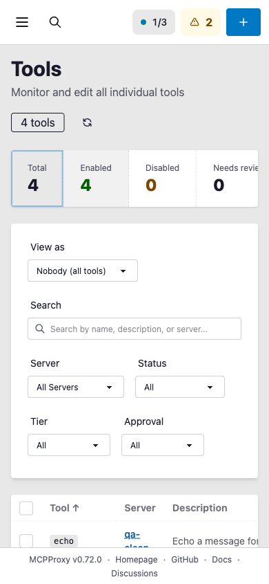
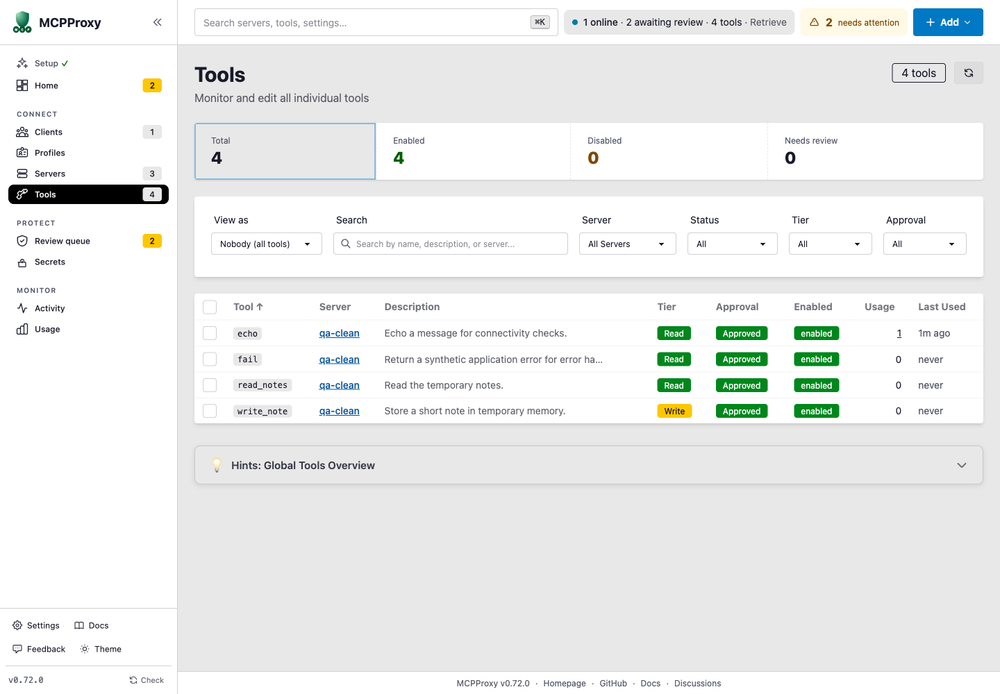
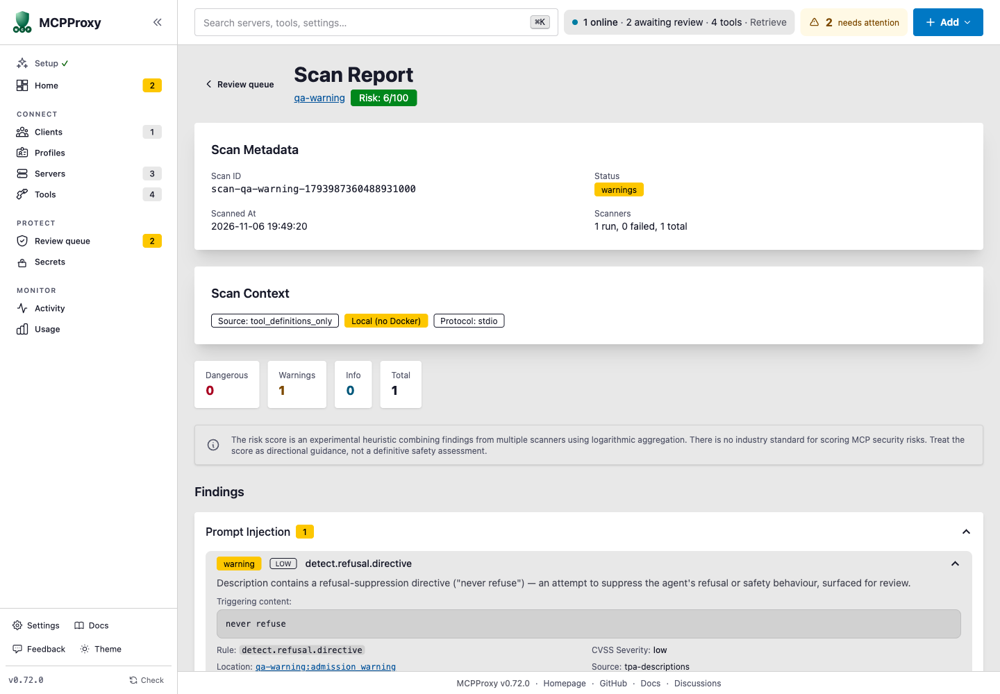

# UX defect verification — 2026-11-06

Base: upstream `main` at `28247002ec8289370d193fdeb6da6a2d2a1b106d`.
Branch: `codex/fix-qa-ux-defects`.

The production frontend and daemon were rebuilt and tested on macOS arm64
with Go 1.26.0, main's exact npm lockfile, and an isolated loopback instance.
All tool traffic used synthetic upstreams and temporary storage.

| Finding | Before | Verified after |
| --- | --- | --- |
| F-01: synchronous scan JSON | Human-readable report on stdout | JSON parses for `-o json`, `--json`, and `MCPPROXY_OUTPUT=json`; YAML contains the report; table output remains readable. Batch scans emit one structured snapshot, including idle, with progress on stderr. |
| F-02: scan freshness | The same stored scan acquired a new timestamp on each GET | Repeated server and job report reads keep the same timestamp. The browser retained `2026-11-06 19:49:20` across reload. Aggregation includes persisted companion-pass completion times even when that pass has no dated report. |
| F-03: refresh accessible name | Unnamed icon-only button | Accessible name is “Refresh tools”; both mouse activation and Enter issue a successful catalog reload. |
| F-04: mobile drawer | The sidebar covered the destination after navigation | At 390×844, navigation clears the checkbox, the drawer becomes hidden, and the destination receives pointer input. Selecting the active link also closes it; desktop navigation remains visible. Aborted navigation keeps the drawer open. |

## Automated checks

```sh
go test ./cmd/mcpproxy ./internal/security/scanner \
  -run 'TestPrintScanSummary|TestSecurityScanAllMachineOutput|TestSecurityCmd_EscapesSlashServerName|TestAggregateReports|TestServiceScanTimestamp' \
  -race -count=1
go test ./internal/security/scanner -count=1
cd frontend
npm exec vitest run
npm run build
```

The focused Go race suite passed 42 tests/subtests. The complete frontend suite
passed 2,795 tests. The scanner package suite, production daemon build and
focused Go lint also passed.

The live candidate rerun passed 14 CLI/REST/MCP cases and five browser cases,
with no uncaught browser errors during the authenticated checks. Anti-refusal
metadata still produced a warning, reconstructed shell metadata remained
dangerous, both servers stayed quarantined, and MCP execution was refused.

The hard-tier corpus gate detected 42/42 gated positives with 0/30 benign
false positives. The review-tier gate detected 42/42 positives with 0/43
hard-negative false positives. These are regression-corpus results, not an
estimate of real-world detection accuracy.

Fresh-context code review: **CLEAN** after checking batch output, companion-pass
timestamps, successful/duplicate/aborted navigation and hook cleanup.

## Screenshots

### Mobile destination after navigation



### Named refresh control



### Persisted scan time and warning evidence


